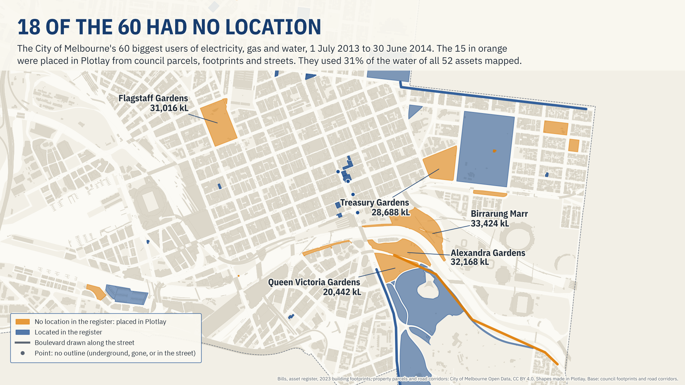
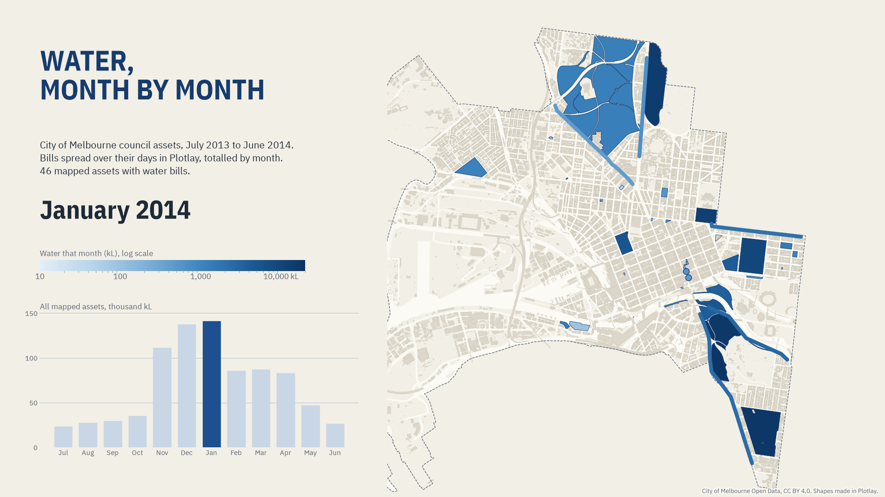

# You can't manage what you can't map

The City of Melbourne's own electricity, gas and water bills, put on a map. **Live version, with an interactive map:** [getplotlay.com/showcase/melbourne-council-energy](https://www.getplotlay.com/showcase/melbourne-council-energy/)



The council publishes its bills as a table: 5,444 electricity, gas and water rows that name an asset ("Garden - Treasury", "Library - East Melbourne"), a start date, an end date and an amount. They are for the financial year **1 July 2013 to 30 June 2014, the newest metered data the council publishes**. This is a method demonstration for facilities and asset managers with real council data, not a statement about the assets today.

**106 of the 316 assets with bills (34%) have no location in the council's asset register.** Of the 60 assets that use 90% of each of electricity, gas and water, 18 have none, Treasury, Flagstaff, Alexandra and Queen Victoria Gardens and Birrarung Marr among them. Placed in [Plotlay](https://www.getplotlay.com) from the council's own parcels, footprints and streets, the 15 that could be placed used **31% of the water on the map**.

[](https://app.plotlay.io/?example=melbourne-council-energy&as=client)

## What the data says

| | FY 2013-14 |
|---|---|
| Council electricity, gas and water | 15,018,207 kWh, 20,654,742 MJ, 995,741 kL |
| Assets with bills / with no location in the register | 316 / 106 |
| Street lighting (two networks, no single place) | 3,646,932 kWh, 24% of electricity |
| Parks and open space | 85% of the water |
| Park water, January over July (19 parks billed every day of the year) | 8.0 times |
| The five gardens with no location | 145,738 kL (Birrarung Marr 33,424, Alexandra 32,168, Flagstaff 31,016, Treasury 28,688, Queen Victoria 20,442) |
| Median park water over its parcel | 421 mm a year (20 parks) |
| Median electricity per m² of estimated floor area | 86 kWh (17 buildings with their own footprint) |

- **Summer water is park water.** Spread over their days and totalled by month, the mapped parks use 7.5 times as much water in January as in July. It is not a billing artefact: for the 19 parks whose water bills cover every day of the year, the ratio is 8.0.
- **Outliers are questions about bills.** Parliament Reserve comes out at 3,710 mm of water a year over its 0.73 ha parcel. Its bills cover 211 of 365 days: none from 15 November 2013 to 28 February 2014, then 25,115 of its 27,257 kL between 1 March and 13 May 2014. Southbank Promenade (1,979 mm) is billed on several meters at once. The Fitzroy Gardens pavilion cafe's meter recorded 38,105 kL, rising 3.8 times from July to January like the garden beside it: it likely serves garden watering too. The map finds them; the bill table explains them.
- **A quarter of the electricity has no building.** Street lighting is billed as two networks. They stay in the table, off the map, and count in every total.
- **Per square metre of floor.** North Melbourne Recreation Centre (a pool and gym) uses about 283 kWh a year per m² of estimated floor area, Council House 1 148, against a median of 86. Floor area is the 2023 footprint times the floors in the council's 2014 building census: an estimate, so a ranking to start questions, not a rating.



### Read it carefully

- **The 60, not everything.** The map covers the 60 assets that use 90% of each measure (92% of electricity, 95% of gas, 91% of water). 52 have a shape. Six networks and two reserves no council layer names stay in the table.
- **Electricity is grid electricity.** The council's Electricity rows; Green Power, cogeneration and solar rows are left out. Council House 2 also makes electricity on site from gas, which is counted under gas.
- **Water depth is over the whole parcel**, not the irrigated area. Most of Royal Park is not irrigated, so it comes out at 6 mm.
- **2023 shapes, 2014 bills.** The City Square car park and the Federation Square visitor centre made way for the Metro Tunnel works: they are points at their register positions, not 2023 footprints. Two leases share their building and are not compared per m².
- **Accuracy** depends on the council's layers the shapes were picked from; areas match a check in GDA2020 MGA zone 55 to within 0.09%.

## How it was made with Plotlay

1. **A map project** on the Geoscience Australia base map, and a **Data layer** called Council assets.
2. **Start from the data.** The council's asset table linked to the empty layer: every row became one to place, with its address beside it.
3. **Pick from a layer.** The council's 2023 building footprints (parts joined by `structure_id`) and property boundaries (parts joined by `property_id`) added with their licence; a click takes the outline under it and gives it the row's name. 21 footprints and 22 parcels; Kings Domain's 5 parcel pieces and Royal Park's 15 are one key each.
4. **Lines and points.** Five boulevards and street reserves drawn as lines along the street (through the centres of the council's road corridor segments); four sites with no outline as points.
5. **Link the bills.** Each bill spread evenly over its days and kept to 1 July 2013 to 30 June 2014, grouped by month, one measure at a time (never added together).
6. **Formulas**: estimated floor area (`floors * area_m2`), water as a depth (`sum(amount, measure = "Water") / area_m2 * 1000`), summer over winter.
7. **Colour** by water on the month slider, by depth with the outliers capped, by electricity divided by floor area with breaks set by hand, and **3D** by value.
8. **Export** GeoJSON, TopoJSON for the Power BI Shape Map, CSV with WKT, the linked data and a Python starter. Nothing in this repository comes from OpenStreetMap or from aerial imagery.

Every shape was checked against the council's parcels and footprints, with the register point marked: [`data/checks/shape_checklist.csv`](data/checks/shape_checklist.csv). Every asset's billing coverage (days billed, overlapping meters) is in [`data/checks/billing_coverage.csv`](data/checks/billing_coverage.csv).

## What's here

| Folder | What |
|---|---|
| [`data/geometry/`](data/geometry) | The 52 shapes from Plotlay: GeoJSON, TopoJSON, CSV with WKT. Key: the council's asset name |
| [`data/assets/`](data/assets) | `assets.csv`: one row per asset, with how its shape was made, its size, floors and days billed |
| [`data/usage/`](data/usage) | `usage_monthly.csv` (by asset, measure and month), `usage_daily.csv` (Plotlay's linked data export), `bills.csv` (the bills as linked) |
| [`data/checks/`](data/checks) | The shape checklist and the billing coverage |
| [`python/`](python) | A narrated notebook that works out every number here: [`council_energy_water.ipynb`](python/council_energy_water.ipynb) |
| [`powerbi/`](powerbi) | A Power BI Project (`.pbip`). Start with [`powerbi/OPEN-ME.md`](powerbi/OPEN-ME.md) |
| [`visuals/`](visuals) | The charts and animations |

### Run the notebook

```
python3 -m venv .venv
.venv/bin/pip install -r python/requirements.txt
cd python && ../.venv/bin/jupyter lab council_energy_water.ipynb
```

### Open the Power BI report

Open `powerbi/MelbourneCouncilEnergy.pbip` in Power BI Desktop and select Refresh. [`powerbi/OPEN-ME.md`](powerbi/OPEN-ME.md) has the steps, including the Shape Map setting Power BI asks for by hand.

## Sources and licences

- **Code** (notebook, Power BI project): MIT, see [`LICENSE`](LICENSE).
- **Our data** (the shapes, tables and checks): CC BY 4.0, see [`LICENSE-DATA`](LICENSE-DATA). Credit "Plotlay (getplotlay.com)" and the sources below.
- Council bills, asset register, 2023 building footprints, property boundaries, road corridors, municipal boundary and the 2014 building census (CLUE): City of Melbourne Open Data, licensed under CC BY 4.0 (https://creativecommons.org/licenses/by/4.0/). Changes: council-controlled electricity, gas and water rows only; bills spread over their days and kept to the financial year; shapes made in Plotlay from the council's layers.
- Base map in the app screenshots: © Commonwealth of Australia (Geoscience Australia), CC BY 4.0.

This is independent work using open data. It is not endorsed by the City of Melbourne. Full credits are in [`NOTICE`](NOTICE).
